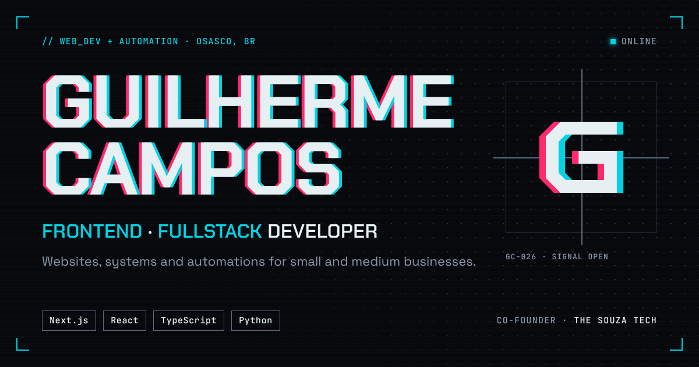

# Guilherme Campos · Portfolio

English · [Português](README.pt-BR.md)



<!-- after the deploy: **Live:** [your-domain](https://your-domain) -->

The developer portfolio of Guilherme Campos, co-founder and developer at [The Souza Tech](https://thesouzatech.com.br). A single page told in acts, with a dark HUD design system, scroll-driven motion and two languages, built to read fully without JavaScript.

## What's on the page

| Act | What happens |
| --- | --- |
| 00 · Boot | A CRT-style boot screen on the first visit of a session. |
| 01 · Hero | The name splits and recedes as you scroll; status panels on the side. |
| 02 · About | A pinned column with the photo, a progress rail, milestones and real numbers. |
| 03 · Projects | A pinned horizontal track: each screenshot is revealed by a mosaic, the title scrambles in. A vertical list on phones. |
| 04 · Stack | A stepped circuit through the tools, with a live trace. |
| 05 · Contact | A diagonal blade in the Alert theme and a copy-email button. |

Plus a 404 (served with a real 404 status) and an error page with a retry flow, both in the Alert theme.

## Stack

- **Framework:** Next.js 16 (App Router, `cacheComponents`, React Compiler), React 19, TypeScript
- **Style:** Tailwind CSS v4 with the Cyberpunk design system tokens in `src/app/globals.css`
- **Motion:** GSAP + ScrollTrigger and Lenis, on one ticker; springs for everything that moves
- **i18n:** next-intl, Portuguese (default) and English at `/pt` and `/en`
- **Theme:** next-themes, Night (default) and Day, plus Alert for whole sections
- **Tests:** Vitest + React Testing Library, Playwright with axe
- **Delivery:** pnpm, GitHub Actions, Vercel

## Getting started

Requires Node 20.9+ and pnpm.

```bash
pnpm install
pnpm dev          # http://localhost:3000
```

| Script | What it does |
| --- | --- |
| `pnpm dev` | Dev server |
| `pnpm build` | Production build (also fails on type errors) |
| `pnpm start` | Serves the production build |
| `pnpm lint` | ESLint |
| `pnpm typecheck` | `next typegen`, then `tsc --noEmit` |
| `pnpm test` | Unit and component tests (Vitest) |
| `pnpm e2e` | Smoke and accessibility tests (Playwright; serves the build on port 3100). The first time, run `pnpm exec playwright install`. |

### Environment

| Variable | Purpose |
| --- | --- |
| `NEXT_PUBLIC_SITE_URL` | The site's public URL, for canonical links, Open Graph and the sitemap. Falls back to Vercel's production URL (`VERCEL_PROJECT_PRODUCTION_URL`). |

## Project structure

```
src/
  app/            routes: [locale] layout and page, not-found, error, sitemap, robots, the client-error API
  components/     design system primitives (Button, BracketPanel, Tag, Terminal, HudFrame…)
  content/        data that isn't translated (projects, stack, acts, site links)
  features/       one folder per act and per piece of chrome (header, hud, footer, special pages, seo…)
  i18n/           next-intl routing and request config
  lib/            motion (GSAP setup, springs, text effects), scroll (Lenis, relayout), errors
  providers/      app-wide providers (intl, theme, Lenis)
  tests/          every test, mirroring the folders of the code it covers
messages/         pt.json and en.json, with the same keys
public/           images, Open Graph cards
```

## How it's built

- **Content first.** Every text renders on the server and reads without JavaScript. Hidden starting states are applied only on the client, so nothing flashes or disappears when scripts fail.
- **Motion that survives real use.** Pages often load mid-scroll (a reload, a language switch, a `#hash` link), so every act jumps to its current state instead of replaying. Pinned acts rebuild in page order on resize.
- **Reduced motion.** With `prefers-reduced-motion`, there's no smooth scroll, no pins and no text effects: the content is simply there.
- **Accessibility.** WCAG 2.1 AA in all three themes, a visible focus ring, readable copies of every split or scrambled text, decorative canvases hidden from screen readers. axe runs in CI.
- **Errors.** Server errors (`onRequestError`) and browser errors (a small reporter posting to `/api/client-error`) end up in the server logs.

## Workflow

Git Flow: features branch off `develop` and merge through pull requests with a green `lint-typecheck-test` check; `main` only receives releases. Commits follow Conventional Commits.

## License

The code is under the [MIT License](LICENSE). The texts, photos and project screenshots are my own and aren't covered by it.

## Author

Guilherme Campos · [The Souza Tech](https://thesouzatech.com.br) · [LinkedIn](https://www.linkedin.com/in/gcampos-dev/) · [GitHub](https://github.com/The-Souza)
