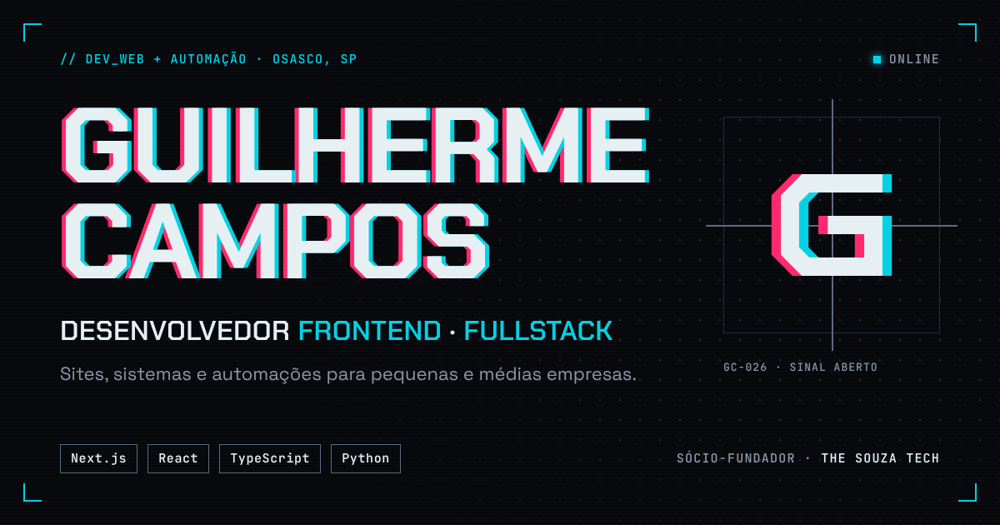

# Guilherme Campos · Portfólio

[English](README.md) · Português



<!-- depois do deploy: **No ar:** [seu-dominio](https://seu-dominio) -->

O portfólio de desenvolvedor de Guilherme Campos, sócio-fundador e desenvolvedor da [The Souza Tech](https://thesouzatech.com.br). Uma página única contada em atos, com um design system de HUD escuro, movimento guiado pela rolagem e duas línguas, feita para ser lida inteira sem JavaScript.

## O que tem na página

| Ato | O que acontece |
| --- | --- |
| 00 · Boot | Uma tela de boot estilo CRT na primeira visita da sessão. |
| 01 · Início | O nome se divide e recua com a rolagem; painéis de status ao lado. |
| 02 · Sobre | Uma coluna fixa com a foto, um trilho de progresso, marcos e números reais. |
| 03 · Projetos | Um trilho horizontal fixo: cada print aparece com um mosaico e o título entra embaralhado. Vira lista vertical no celular. |
| 04 · Stack | Um circuito em escada pelas ferramentas, com um traço vivo. |
| 05 · Contato | Uma lâmina diagonal no tema Alerta e um botão de copiar e-mail. |

Mais uma 404 (servida com status 404 de verdade) e uma página de erro com fluxo de nova tentativa, as duas no tema Alerta.

## Stack

- **Framework:** Next.js 16 (App Router, `cacheComponents`, React Compiler), React 19, TypeScript
- **Estilo:** Tailwind CSS v4 com os tokens do design system Cyberpunk em `src/app/globals.css`
- **Movimento:** GSAP + ScrollTrigger e Lenis, num ticker só; springs em tudo que se mexe
- **i18n:** next-intl, português (padrão) e inglês em `/pt` e `/en`
- **Tema:** next-themes, Noite (padrão) e Dia, mais Alerta em seções inteiras
- **Testes:** Vitest + React Testing Library, Playwright com axe
- **Entrega:** pnpm, GitHub Actions, Vercel

## Como rodar

Precisa de Node 20.9+ e pnpm.

```bash
pnpm install
pnpm dev          # http://localhost:3000
```

| Script | O que faz |
| --- | --- |
| `pnpm dev` | Servidor de desenvolvimento |
| `pnpm build` | Build de produção (também falha em erro de tipo) |
| `pnpm start` | Serve o build de produção |
| `pnpm lint` | ESLint |
| `pnpm typecheck` | `next typegen`, depois `tsc --noEmit` |
| `pnpm test` | Testes unitários e de componentes (Vitest) |
| `pnpm e2e` | Testes de smoke e de acessibilidade (Playwright; serve o build na porta 3100). Na primeira vez, rode `pnpm exec playwright install`. |

### Ambiente

| Variável | Para quê |
| --- | --- |
| `NEXT_PUBLIC_SITE_URL` | A URL pública do site, para links canônicos, Open Graph e o sitemap. Sem ela, usa a URL de produção da Vercel (`VERCEL_PROJECT_PRODUCTION_URL`). |

## Estrutura

```
src/
  app/            rotas: layout e página de [locale], not-found, error, sitemap, robots, a API de client-error
  components/     primitivos do design system (Button, BracketPanel, Tag, Terminal, HudFrame…)
  content/        dados que não são traduzidos (projetos, stack, atos, links do site)
  features/       uma pasta por ato e por peça de interface (header, hud, footer, páginas especiais, seo…)
  i18n/           roteamento e configuração do next-intl
  lib/            motion (setup do GSAP, springs, efeitos de texto), scroll (Lenis, relayout), errors
  providers/      providers da aplicação (intl, tema, Lenis)
  tests/          todos os testes, espelhando as pastas do código que cobrem
messages/         pt.json e en.json, com as mesmas chaves
public/           imagens, cards de Open Graph
```

## Como é feito

- **Conteúdo primeiro.** Todo texto é renderizado no servidor e lido sem JavaScript. Os estados iniciais ocultos só são aplicados no cliente, então nada pisca nem some se os scripts falharem.
- **Movimento que aguenta o uso real.** A página muitas vezes carrega no meio da rolagem (um reload, uma troca de idioma, um link com `#hash`), então cada ato pula para o estado atual em vez de repetir a animação. Os atos fixos se reconstroem em ordem no resize.
- **Movimento reduzido.** Com `prefers-reduced-motion`, não há rolagem suave, pins nem efeitos de texto: o conteúdo simplesmente está lá.
- **Acessibilidade.** WCAG 2.1 AA nos três temas, anel de foco visível, cópias legíveis de todo texto dividido ou embaralhado, canvas decorativos escondidos de leitores de tela. O axe roda no CI.
- **Erros.** Erros do servidor (`onRequestError`) e do navegador (um pequeno reporter que envia para `/api/client-error`) vão para os logs do servidor.

## Fluxo de trabalho

Git Flow: features saem de `develop` e entram por pull request com o check `lint-typecheck-test` verde; `main` só recebe releases. Commits seguem Conventional Commits.

## Licença

O código está sob a [licença MIT](LICENSE). Os textos, as fotos e os prints dos projetos são meus e não entram nela.

## Autor

Guilherme Campos · [The Souza Tech](https://thesouzatech.com.br) · [LinkedIn](https://www.linkedin.com/in/gcampos-dev/) · [GitHub](https://github.com/The-Souza)
